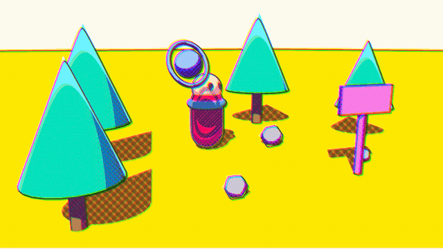
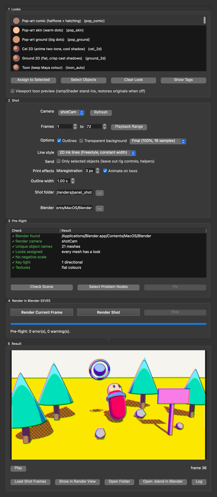
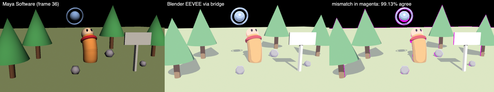
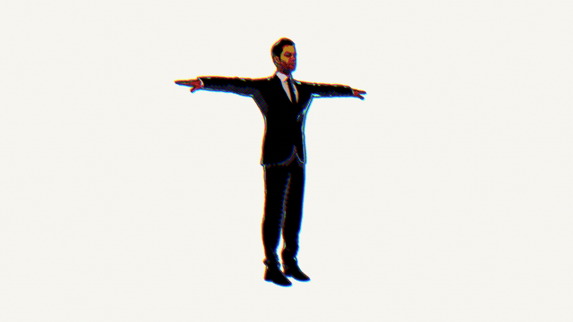
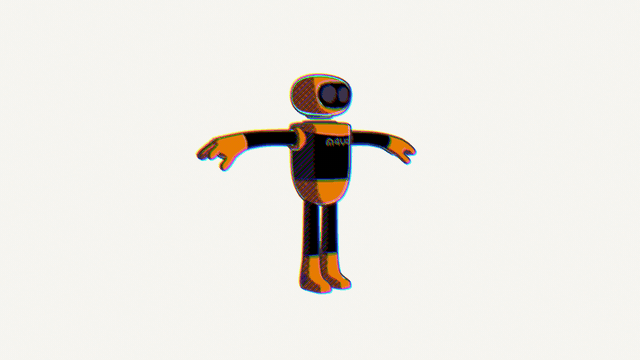
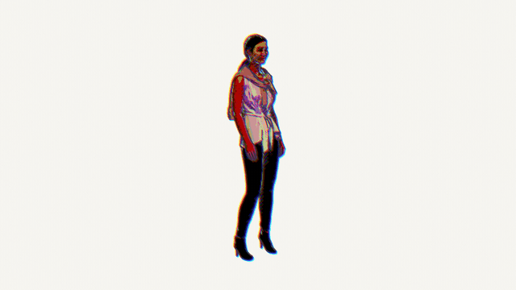
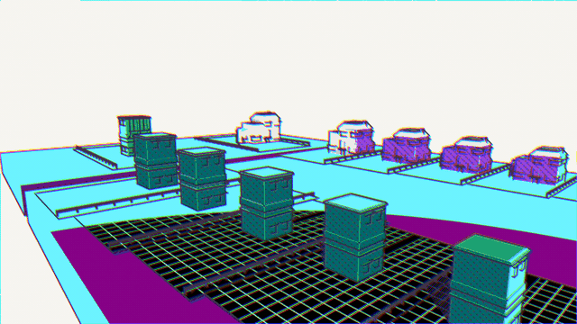

# Toon Bridge: render Maya shots with a Blender EEVEE pop-art comic look

**Jianrui (Jerry) Xu · SVA MFA Computer Arts · Research Project · Nov 2026**

Toon Bridge is a Maya panel. You tag objects with stylized looks built in Blender's
node editor, press **Render**, and a background copy of Blender renders the shot
with EEVEE. The frames come back into Maya. The main look is a **pop-art comic
style** (inspired by the comic-book look of films like *Spider-Man: Into the
Spider-Verse*): halftone dots, hatching, ink lines, off-register print colours
and animation on twos. Plain cel looks are included too.



*The demo shot: modelled, rigged, animated and lit in Maya; rendered by Blender
EEVEE through Toon Bridge in the pop-art comic look.*

| ▶ Videos | |
|---|---|
| [**Demo video**](docs/video/toon_bridge_demo.mp4) (43 s) | Maya render vs Toon Bridge side by side, print effects on/off, look library, camera match |
| [**Stress-test video**](docs/video/stress_test.mp4) (35 s) | scanned humans, a robot rig and a town environment from Maya's example scenes, all through the bridge |
| **Screen recording in Maya** | SCREEN_RECORDING_LINK |

---

## How to use it



**Install once**
1. Install **Blender 4.2+** (tested with 5.3). On a Mac it is found automatically in `/Applications`.
2. Clone this repo, then **drag `drag_into_maya.py` into a Maya viewport.**
   That adds the repo to Maya's Python path, puts a **Toon** button on your
   shelf, and opens the panel. Next time, just click **Toon**.

**Every shot: work down the panel, 1 → 5**

| | Section | What you do |
|---|---|---|
| **1** | **Looks** | Select meshes in the viewport → click a look (e.g. *Pop-art comic*) → **Assign to Selected**. Tick *Viewport toon preview* to see rough bands in Maya. |
| **2** | **Shot** | Pick your **camera** and **frames**. Choose *Line style* and *Print effects* (misregistration px, animate on twos). Tick **Only selected objects** to leave rig controls out. |
| **3** | **Pre-flight** | **Check Scene**. Red = must fix, yellow = OK but read it. Double-click a row to select the problem objects; **Fix** repairs it (e.g. duplicate names). |
| **4** | **Render** | **Render Current Frame** (one frame in ~2 s, opens in Render View) or **Render Shot**. Maya stays usable; Blender works in the background. |
| **5** | **Result** | Frames appear as they finish. **Play** the flipbook, **Open Folder**, or **Open .blend in Blender** to tweak the scene there. |

**Try it in one minute:** open `demo/toon_demo.ma` (looks already assigned),
choose `shotCam`, press **Render Current Frame**.

**Presentation scene:** `demo/presentation.ma`, a rooftop jump at dusk staged for a
live demo (the hero has no look yet, two buildings share a name for pre-flight
to catch). Step-by-step script: [docs/PRESENTATION_DEMO.md](docs/PRESENTATION_DEMO.md).

**Your own looks:** open `blender/look_library.blend` in Blender, edit a
material's nodes and save. Every render from Maya uses your edits. New looks go
in `blender/looks.json`.

<br clear="right">

## What I set out to do

My proposal ([docs/PROPOSAL.md](docs/PROPOSAL.md)) had two ideas: a
**Maya–Blender Toon Bridge** and a **Maya Scene Pre-flight** checker. I asked
whether to pick one or combine them. I picked the **Toon Bridge** as the
research goal and kept a small **Pre-flight** as a gate before sending
anything to Blender, which was the "combine" option.

The idea: toon shading in Maya/Arnold (`aiToon`) is rigid and does not preview
as toon. In Blender, the look is a few nodes (Shader to RGB → Constant Color
Ramp), but those nodes only exist in EEVEE, so the look can't be *translated*
to Arnold. Instead, Blender becomes Maya's stylized renderer.

**Smallest version that still counts** (from the proposal): one button that
renders the current frame in Blender with my toon materials and shows it in
Maya. ✅ Done: **Render Current Frame** does this, and **Render Shot**
renders the whole animation.

## How it changed, and why

| Proposal | What I built | Why |
|---|---|---|
| Geometry via Alembic **or USD** | **Alembic** for geometry + **shot.json** for camera, lights, looks | Alembic bakes skinned/deformed meshes per frame and Blender imports it reliably. Camera and lights go as raw Maya numbers so the conversion lives in *one tested file* instead of inside two importers. |
| Look library in a hand-made .blend | Looks are **data** (`looks.json`); a script builds `look_library.blend` | Reproducible and easy to diff. You can still edit the materials by hand in Blender: render.py appends them from the .blend by name. |
| Cel-shaded (3D-to-2D) looks | **Pop-art comic** look as the main style; cel looks kept | After testing the cel looks I wanted a stronger graphic, printed-comic style: screen-space halftone, hatching, misregistration and animating on twos. |
| Outlines with **Line Art** or inverted hull | **Two line styles**: 2D ink lines (Freestyle, the default) and 3D inverted-hull outlines | The hull is a 3D shell, so lines thin out with distance and read as 3D. For a real 3D-to-2D look I added Freestyle strokes with a constant pixel width, plus inner crease lines. |
| Pre-flight as a separate tool | Pre-flight **inside** the bridge (7 checks, 3 with one-click fixes) | The "combine" option from the proposal: checks what the bridge needs (unique names, looks, lights...). |
| Viewport shows a Maya preview | Viewport preview with **rampShader** stand-ins | Not in the proposal: added so artists see bands in Maya before rendering. |
| Live-link ("preview current frame" fast button) | Not built; current frame renders in **~1.6 s** anyway | Blender starts headless fast enough that a persistent server wasn't needed for this shot. |

## The pop-art comic look

| Effect | How it's made |
|---|---|
| **Halftone (Ben-Day) dots** that grow in shadow | Shader to RGB gives the light value; a 45° dot grid in **screen space** (Texture Coordinate → Window) draws dots whose radius grows as the light gets darker |
| **Hatching** in the darkest shadow | diagonal screen-space stripes where the light value is below a threshold |
| **Flat, punchy colour** | lit/shadow posterize + a saturation boost; shadows tinted purple, not grey |
| **Coloured rim light** | Layer Weight (facing) above a threshold mixes in a cyan/magenta edge colour |
| **Ink lines** | Freestyle strokes with a constant pixel width (silhouette + creases) |
| **Misregistration** | after each frame, the red plate shifts right/down and the blue plate left/up by N px (numpy in Blender) |
| **Animate on twos** | render every other frame and hold it for two frames, which gives a hand-drawn rhythm |

Looks: `pop_comic` (keeps the Maya colour), `pop_skin`, `pop_ground`. Panel options: *Print effects* (misregistration px, on twos).

## What I made

* **Maya panel** (`toon_bridge/ui.py`), dockable, in five steps:
  1. **Looks**: list with painted swatches; Assign / Select / Clear; viewport toon preview toggle
  2. **Shot**: camera, frame range, outlines on/off and width, transparent background, preview/final quality, Blender path
  3. **Pre-flight**: traffic-light checks; double-click selects the problem nodes; **Fix** button where a fix is safe
  4. **Render**: Current Frame / Shot / Stop; progress bar; Maya stays usable while Blender renders
  5. **Result**: frames appear as they render; flipbook playback; Show in Render View; Open Folder; **Open .blend in Blender**
* **12 looks** (`blender/looks.json`): **Pop comic, Pop skin, Pop ground** (halftone),
  Cel 2D (anime two-tone with cool shadow), Ground 2D, Toon (keep Maya colour), Anime skin, Comic cel, Cel metal
  (bands + specular + rim), Painted ground, Flat 2D, Manga.
* **Two line styles**: *2D ink lines* (Freestyle; constant width on screen,
  silhouette + crease) or *3D hull outlines* (per-look width), or both.

  

* **Exact conversion** of axes (Y-up → Z-up), units (cm → m), camera film back
  and fit, and directional-light intensity, in `toon_bridge/convert.py`, with tests.
* **A demo shot** (`demo/toon_demo.ma`, rebuilt by `demo/make_demo_scene.py`):
  a skinned character that bends and hops, a floating drone, trees, rocks, a
  signpost, a moving camera with a zoom, and a sun that sweeps across the shot.

How every part works, and why: **[docs/HOW_IT_WORKS.md](docs/HOW_IT_WORKS.md)**.

```
 MAYA                                          BLENDER (headless: blender -b)
 Looks panel: toonLook tag per mesh            look_library.blend (from looks.json)
 Pre-flight checks                              render.py:
 Export: scene.abc  (geometry + animation) ──►   import Alembic (cm→m, Y→Z up)
         shot.json  (camera, lights, looks) ──►   append looks, assign by name, outlines
 QProcess runs Blender, reads progress     ◄──   camera + lights from shot.json (convert.py)
 Frames in flipbook / Render View          ◄──   EEVEE → frames/toon.####.png + toon_shot.blend
```

## Command line and scripting

```bash
mayapy tests/run_end_to_end.py --all --pop     # demo: build, check, export, render all frames, verify
mayapy tests/stress_scenes.py                  # Maya example scenes through the bridge (+ GIFs, video)
blender -b --factory-startup --python blender/render.py -- path/to/shot.json [--frame 12] [--preview]
blender -b --python blender/build_library.py -- --sheet docs/images/look_sheet.png   # rebuild looks
```
From Python in Maya: `toon_bridge.exporter.export_shot(camera, start, end, folder)` writes
the shot; `toon_bridge.launcher.build_command(shot_json)` gives the Blender command.

## How I verified it

| Check | Result |
|---|---|
| `python3 -m unittest discover tests` (conversion maths) | 6/6 pass |
| `blender -b --factory-startup --python tests/light_match_blender.py` | Maya intensity 1.0/0.5/1.5 → Blender 0.500/0.400/0.600, the same as Maya's Lambert result to 3 decimals |
| `mayapy tests/camera_match.py 36`: Maya Software vs Blender, same frame | **99.20%** of pixels agree on object vs background; the rest are 1-px antialiased edges ([image](docs/images/camera_match_36.png)) |
| `mayapy tests/run_end_to_end.py --all` | 72/72 frames, 1280×720, rendered in 35 s; PASS |
| Pre-flight test with planted problems (duplicate name, unknown look, mirrored mesh) | all found; fixes resolved name/look errors |
| `mayapy tests/ui_smoke.py`: the real panel, buttons pressed from code | 13/13, 5 runs in a row (after fixing an intermittent crash, see below): looks listed, assign, select, preview on/off, pre-flight, Render Current Frame through the background Blender job, frame shown in the viewer |
| `mayapy demo/make_video.py` | renders the shot 3 ways (Maya Software, hull, ink) and builds the demo video |



### Stress test: real characters and an environment (`mayapy tests/stress_scenes.py`)

The demo is my own simple scene, so I also ran the example scenes that ship
with Maya 2026 through the whole tool: open → pre-flight + fixes → orbiting
test camera → export 48 frames → render in the pop-art look.
**▶ [Stress-test video](docs/video/stress_test.mp4)**

| Character: rigged scanned human | Character: robot rig |
|---|---|
|  |  |
| **Character: 100k-polygon scan** | **Environment: town** |
|  |  |

| Scene | What makes it hard | Result (48 frames) |
|---|---|---|
| `rp_eric_rigged_HIK_arnold` | scanned human, HumanIK rig (142 joints, skinned), Arnold shader without Arnold installed, colour map behind a composite node | OK, 7.5 s. Texture found by searching upstream of the unknown shader |
| `M4Y4-B07` robot rig | 23 meshes, 10 skin clusters, expression control meshes, standardSurface + textures | OK, 7.1 s. Pre-flight fixed **10 duplicate names**; control shapes left out |
| `rp_sophia_posed_100k_arnold` | 100,002-polygon scan, textured | OK, 14.6 s |
| `Interactive_LightingAndShading` (town) | environment: 63 meshes, 39,803 polys, `houses:` namespace, 30 textured, 4 non-directional lights | OK, 20.6 s. Pre-flight fixed **40 duplicate names** created by stripping the namespace |
| `TutorialBuildingDemo` | tutorial scene with UI scripts that run on open | OK after opening with script nodes off (the scripts crashed headless Maya, not the bridge) |

**What the stress test changed in the tool:** texture support (colour maps are sent
and posterized under the halftone), finding colour maps behind unknown/Arnold
shaders, an "Only selected objects" option, and a better pre-flight texture check.

**What it showed still needs work:** photo textures + the pop look's saturation
boost go garish (cyan/purple streets); my joint-rotation test did nothing on the
HumanIK rig (the rig drives the joints), so deformation on these rigs was only
tested on my own skinned demo character.

## What I learned

* **Bisecting a crash.** The panel crashed headless Maya in about half the runs.
  Turning suspects off one at a time showed it was a `processEvents()` call
  during export (pumping Qt events while Maya was mid-command). Removed: 5/5 passes.
* **3D-to-2D needs screen-space lines.** World-space outlines (inverted hull)
  get thinner with distance, so the image still reads as 3D. Freestyle strokes
  have a constant pixel width and also draw inner creases, which reads as drawn.
* **Freestyle has a weak spot where objects intersect.** The character's rounded
  bottom was buried in the ground, and Freestyle drew a ghost line there and dropped
  the real silhouette. Resting the mesh on the ground fixed it; it's listed under limits.

* **Coordinate systems are the whole game.** Y-up vs Z-up, cm vs m, row vs
  column matrices, inches vs mm, four film-fit modes vs two. Writing one
  conversion file with tests, then checking it against a Maya render pixel by
  pixel, was faster than guessing in either program.
* **Light units have a reason.** Blender's sun is irradiance and its diffuse
  BSDF divides by π, so the sun strength is π × Maya's intensity. I could only
  trust that after rendering a test patch and reading the pixel value.
* **Toon shading magnifies noise.** Shader to RGB posterizes everything it
  sees, including EEVEE's ray-traced GI and soft-shadow jitter, which made
  speckled band edges. Turning those off gave clean bands.
* **The inverted-hull outline casts a shadow on its own object.** It made
  blocky patches on the lit side. The fix: the outline is transparent to
  shadow rays (Light Path → Is Shadow Ray).
* **Driving one app from another**: run Blender headless, keep Maya responsive
  with QProcess, and talk through a simple line protocol (`TOONBRIDGE FRAME …`).
  Maya's `PYTHONHOME` has to be removed so Blender doesn't load Maya's Python.

## What doesn't work yet

* **Textures**: one colour map per object is used (no UDIMs, no per-face materials);
  photo textures look garish with the pop look's saturation boost.
* **Misregistration wraps at the frame edge** (a 3-px coloured line on the opposite border).
* **Halftone dots are screen-locked**: they don't stick to the surface when the camera moves (that's the printed look, but some shots may want object-space dots).
* **Point/spot/area light intensity** is approximate (directional is exact);
  Arnold lights (aiAreaLight, skydome) are not converted.
* **Multiple materials on one mesh** (per-face shading groups) get one look for the whole mesh.
* **Freestyle lines near intersections**: geometry pushed through other geometry
  (e.g. feet sunk into the ground) can get a stray line; use hull outlines for such shots.
* **Mirrored (negative-scale) meshes** can show inverted outlines; pre-flight warns but can't fix it safely.
* **Viewport preview** is a rough rampShader stand-in, not the EEVEE look.
* Tested on macOS only; Windows/Linux Blender paths are written but untested.

## What I'd do next

* **Push the comic style further**: colour offset that grows with depth (out-of-focus
  areas split into colour plates instead of blurring), hatching that follows the form,
  hand-painted inner ink lines, and a paper/print texture.

1. **Live link**: keep one Blender running as a socket server so scrubbing
   the timeline re-renders in under a second.
2. **Line Art outlines** as a second outline style (creases, intersections).
3. Per-face looks from Alembic face sets; texture support (send the file
   path, posterize the texture colour).
4. Arnold light conversion (aiAreaLight, aiSkyDomeLight → world).
5. A look editor in the Maya panel (band positions/colours) that writes `looks.json`.

## Repo map

```
toon_bridge/   Maya package: ui.py, looks.py, preflight.py, exporter.py, launcher.py, convert.py
blender/       render.py, toon_materials.py, build_library.py, looks.json, look_library.blend
demo/          make_demo_scene.py, toon_demo.ma, make_video.py,
               make_presentation_scene.py, presentation.ma, prerender_presentation.py, textures/
tests/         test_convert.py, light_match_blender.py, camera_match.py, run_end_to_end.py, ui_smoke.py, stress_scenes.py
docs/          HOW_IT_WORKS.md, PROPOSAL.md (original), images/, video/
drag_into_maya.py   installer
```
