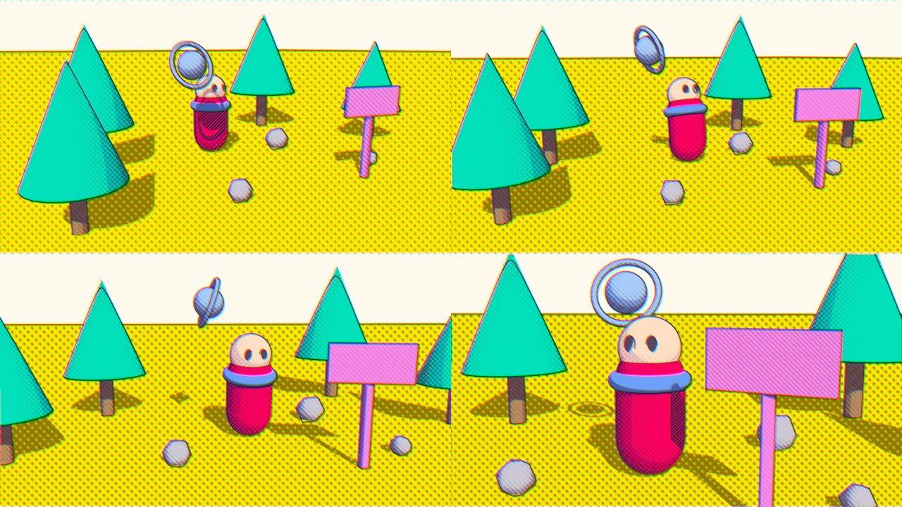
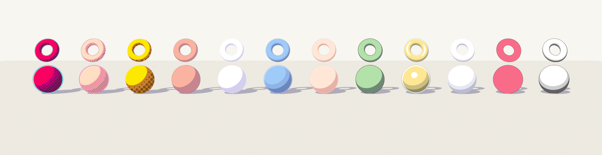

# Toon Bridge: render Maya shots with Blender EEVEE cel shading

**Jianrui (Jerry) Xu · SVA MFA Computer Arts · Research Project · Nov 2026**

Toon Bridge is a Maya panel. You tag objects with toon looks built in Blender's
node editor, press **Render**, and a background copy of Blender renders the shot
with EEVEE. The cel-shaded frames come back into Maya.

**▶ Demo video (1–3 min): VIDEO_LINK_HERE**



*Four frames of the demo shot. Modelled, rigged, animated and lit in Maya;
rendered by Blender EEVEE through Toon Bridge.*

---

## What I set out to do

My proposal ([docs/PROPOSAL.md](docs/PROPOSAL.md)) had two ideas: a
**Maya–Blender Toon Bridge** and a **Maya Scene Pre-flight** checker. I asked
whether to pick one or combine them. I picked the **Toon Bridge** as the
research goal and kept a small **Pre-flight** as a gate before sending
anything to Blender, which was the "combine" option.

The idea: toon shading in Maya/Arnold (`aiToon`) is rigid and does not preview
as toon. In Blender, the look is a few nodes (Shader to RGB → Constant Color
Ramp), but those nodes only exist in EEVEE, so the look can't be *translated*
to Arnold. Instead, Blender becomes Maya's stylized renderer.

**Smallest version that still counts** (from the proposal): one button that
renders the current frame in Blender with my toon materials and shows it in
Maya. ✅ Done: **Render Current Frame** does this, and **Render Shot**
renders the whole animation.

## How it changed, and why

| Proposal | What I built | Why |
|---|---|---|
| Geometry via Alembic **or USD** | **Alembic** for geometry + **shot.json** for camera, lights, looks | Alembic bakes skinned/deformed meshes per frame and Blender imports it reliably. Camera and lights go as raw Maya numbers so the conversion lives in *one tested file* instead of inside two importers. |
| Look library in a hand-made .blend | Looks are **data** (`looks.json`); a script builds `look_library.blend` | Reproducible and easy to diff. You can still edit the materials by hand in Blender: render.py appends them from the .blend by name. |
| Outlines with **Line Art** or inverted hull | **Inverted hull** (Solidify) | Works per object, per look, with no Grease Pencil setup, and renders fast. Line Art is in "next". |
| Pre-flight as a separate tool | Pre-flight **inside** the bridge (7 checks, 3 with one-click fixes) | The "combine" option from the proposal: checks what the bridge needs (unique names, looks, lights...). |
| Viewport shows a Maya preview | Viewport preview with **rampShader** stand-ins | Not in the proposal: added so artists see bands in Maya before rendering. |
| Live-link ("preview current frame" fast button) | Not built; current frame renders in **~1.6 s** anyway | Blender starts headless fast enough that a persistent server wasn't needed for this shot. |

## What I made

* **Maya panel** (`toon_bridge/ui.py`), dockable, in five steps:
  1. **Looks**: list with painted swatches; Assign / Select / Clear; viewport toon preview toggle
  2. **Shot**: camera, frame range, outlines on/off and width, transparent background, preview/final quality, Blender path
  3. **Pre-flight**: traffic-light checks; double-click selects the problem nodes; **Fix** button where a fix is safe
  4. **Render**: Current Frame / Shot / Stop; progress bar; Maya stays usable while Blender renders
  5. **Result**: frames appear as they render; flipbook playback; Show in Render View; Open Folder; **Open .blend in Blender**
* **7 toon looks** (`blender/looks.json`): Toon (keep Maya colour), Anime skin,
  Comic cel, Cel metal (bands + specular + rim), Painted ground, Flat 2D, Manga.

  

* **Exact conversion** of axes (Y-up → Z-up), units (cm → m), camera film back
  and fit, and directional-light intensity, in `toon_bridge/convert.py`, with tests.
* **A demo shot** (`demo/toon_demo.ma`, rebuilt by `demo/make_demo_scene.py`):
  a skinned character that bends and hops, a floating drone, trees, rocks, a
  signpost, a moving camera with a zoom, and a sun that sweeps across the shot.

How every part works, and why: **[docs/HOW_IT_WORKS.md](docs/HOW_IT_WORKS.md)**.

```
 MAYA                                          BLENDER (headless: blender -b)
 Looks panel: toonLook tag per mesh            look_library.blend (from looks.json)
 Pre-flight checks                              render.py:
 Export: scene.abc  (geometry + animation) ──►   import Alembic (cm→m, Y→Z up)
         shot.json  (camera, lights, looks) ──►   append looks, assign by name, outlines
 QProcess runs Blender, reads progress     ◄──   camera + lights from shot.json (convert.py)
 Frames in flipbook / Render View          ◄──   EEVEE → frames/toon.####.png + toon_shot.blend
```

## How to run it

**Needs:** Maya 2026 (Maya 2025 and other PySide6 versions should work too) and
**Blender 4.2 or newer** (tested with 5.3.0). On macOS Blender is found
automatically in `/Applications`; otherwise set its path in the panel.

1. Clone: `git clone https://github.com/JerryXu52/Maya-Pipeline-Research-Project.git`
2. **Install**: drag `drag_into_maya.py` into a Maya viewport. It adds the repo
   to Maya's Python path (now and at startup, via `userSetup.py`), puts a
   **Toon** button on the current shelf, and opens the panel.
   *Or* in the Script Editor (Python):
   ```python
   import sys; sys.path.append("/path/to/Maya-Pipeline-Research-Project")
   import toon_bridge.ui as tb; tb.show()
   ```
3. **Try the demo**: open `demo/toon_demo.ma` (looks are already assigned), choose
   camera `shotCam`, press **Render Current Frame**, then **Render Shot**.
4. **Your own scene**: select meshes → pick a look → **Assign to Selected**.
   Add a directional light (pre-flight offers to), pick your camera, and render.
   Frames go to `<scene folder>/toon_bridge/<scene name>/frames/`.

**Command line** (no Maya UI):
```bash
mayapy tests/run_end_to_end.py --all          # demo: build, check, export, render all frames, verify
blender -b --factory-startup --python blender/render.py -- path/to/shot.json [--frame 12] [--preview]
blender -b --python blender/build_library.py -- --sheet docs/images/look_sheet.png   # rebuild looks
```

## How I verified it

| Check | Result |
|---|---|
| `python3 -m unittest discover tests` (conversion maths) | 6/6 pass |
| `blender -b --factory-startup --python tests/test_light_match.py` | Maya intensity 1.0/0.5/1.5 → Blender 0.500/0.400/0.600, the same as Maya's Lambert result to 3 decimals |
| `mayapy tests/camera_match.py 36`: Maya Software vs Blender, same frame | **99.13%** of pixels agree on object vs background; the rest are 1-px antialiased edges ([image](docs/images/camera_match_36.png)) |
| `mayapy tests/run_end_to_end.py --all` | 72/72 frames, 1280×720, rendered in 35 s; PASS |
| Pre-flight test with planted problems (duplicate name, unknown look, mirrored mesh) | all found; fixes resolved name/look errors |
| Live Maya 2026 GUI: panel, assign, preview, render frame + shot, Render View | see demo video |


## What I learned

* **Coordinate systems are the whole game.** Y-up vs Z-up, cm vs m, row vs
  column matrices, inches vs mm, four film-fit modes vs two. Writing one
  conversion file with tests, then checking it against a Maya render pixel by
  pixel, was faster than guessing in either program.
* **Light units have a reason.** Blender's sun is irradiance and its diffuse
  BSDF divides by π, so the sun strength is π × Maya's intensity. I could only
  trust that after rendering a test patch and reading the pixel value.
* **Toon shading magnifies noise.** Shader to RGB posterizes everything it
  sees, including EEVEE's ray-traced GI and soft-shadow jitter, which made
  speckled band edges. Turning those off gave clean bands.
* **The inverted-hull outline casts a shadow on its own object.** It made
  blocky patches on the lit side. The fix: the outline is transparent to
  shadow rays (Light Path → Is Shadow Ray).
* **Driving one app from another**: run Blender headless, keep Maya responsive
  with QProcess, and talk through a simple line protocol (`TOONBRIDGE FRAME …`).
  Maya's `PYTHONHOME` has to be removed so Blender doesn't load Maya's Python.

## What doesn't work yet

* **Textures**: looks use one flat colour per object; textured objects come out grey.
* **Point/spot/area light intensity** is approximate (directional is exact);
  Arnold lights (aiAreaLight, skydome) are not converted.
* **Multiple materials on one mesh** (per-face shading groups) get one look for the whole mesh.
* **Mirrored (negative-scale) meshes** can show inverted outlines; pre-flight warns but can't fix it safely.
* **Viewport preview** is a rough rampShader stand-in, not the EEVEE look.
* Tested on macOS only; Windows/Linux Blender paths are written but untested.

## What I'd do next

1. **Live link**: keep one Blender running as a socket server so scrubbing
   the timeline re-renders in under a second.
2. **Line Art outlines** as a second outline style (creases, intersections).
3. Per-face looks from Alembic face sets; texture support (send the file
   path, posterize the texture colour).
4. Arnold light conversion (aiAreaLight, aiSkyDomeLight → world).
5. A look editor in the Maya panel (band positions/colours) that writes `looks.json`.

## Repo map

```
toon_bridge/   Maya package: ui.py, looks.py, preflight.py, exporter.py, launcher.py, convert.py
blender/       render.py, toon_materials.py, build_library.py, looks.json, look_library.blend
demo/          make_demo_scene.py, toon_demo.ma
tests/         test_convert.py, test_light_match.py, camera_match.py, run_end_to_end.py
docs/          HOW_IT_WORKS.md, PROPOSAL.md (original), images/
drag_into_maya.py   installer
```
