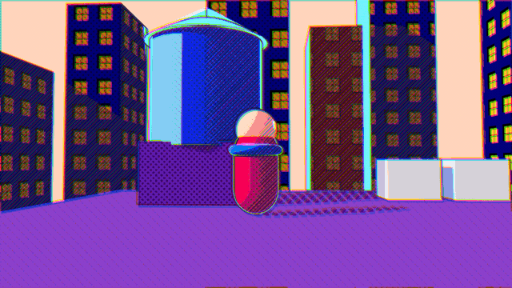

# Live demo script: `demo/presentation.ma`

A rooftop jump at dusk, staged so each step of the tool has something to show.
About 2 minutes. Rebuild the scene any time with `mayapy demo/make_presentation_scene.py`;
pre-render its frames with `mayapy demo/prerender_presentation.py`.

## What is staged in the scene

| Staged | So that you can show |
|---|---|
| The hero (`bean_body`, `bean_head`, eyes, scarf) has **no look** | assigning a look live (step 1) |
| Two skyline buildings are both named **`tower`** (in `skyline_near` and `skyline_far`) | pre-flight's red error and its one-click **Fix** (step 3) |
| The three rooftop **AC units** have no look | a yellow warning and **Fix: Tag as toon_auto** (step 3) |
| Buildings use a **tiled window texture** | textures coming through, posterized under the halftone |
| Camera `shotCam` follows the jump; the sun is low and warm; the sky colour is saved in the scene | the camera and light conversion, the Background swatch |
| Frames 1–96 are **pre-rendered** in `demo/toon_bridge/presentation/frames/` | **Load Shot Frames** plays the result instantly |

## Before class

1. Pre-render the shot (about a minute), so the flipbook is ready. Either:
   - **Terminal:** `/Applications/Autodesk/maya2026/Maya.app/Contents/bin/mayapy demo/prerender_presentation.py`
   - **Inside Maya:** open `demo/prerender_presentation.py` in the Script Editor (Python tab) and run it.
     It starts a separate background job, so your open scene is not touched; a message
     at the top of the viewport says when the 96 frames are done.
2. In Maya: drag `drag_into_maya.py` into the viewport, then open `demo/presentation.ma`.
3. Dock the panel on the right; set the viewport to look through `shotCam`, frame 36.

## Live, step by step

| # | Do | Say |
|---|---|---|
| 1 | Select the hero's body and scarf → **Pop-art comic** → **Assign to Selected**. Select the head → **Pop-art skin** → Assign. Select both eyes → **Flat 2D** → Assign. | "Each object gets a look; it's a string attribute on the object." |
| 2 | Tick **Viewport toon preview**, then untick it. | "A rough preview in Maya with ramp shaders; the originals come back when it's off." |
| 3 | Click **Check Scene**. Red row: *2 meshes share a name*. Double-click it (the two towers get selected), click **Fix: Rename with suffix**. Yellow row: *3 meshes have no look* → **Fix: Tag as toon_auto**. Check again: all green. | "Blender re-applies looks by name, so duplicate names would mix them up. Pre-flight catches it before anything is sent." |
| 4 | Point at **2 Shot**: `shotCam`, frames 1–96, *2D ink lines*, misregistration 3 px, *Animate on twos*, the dusk **Background** swatch. | "These are the comic options." |
| 5 | Click **Render Current Frame**. Render View opens with frame 36 in about 2 seconds. | "Maya exports, Blender renders in the background, the frame comes back. Maya stays usable." |
| 6 | Click **Load Shot Frames**, then **Play**. | "The whole 96-frame shot, rendered earlier with the same button." |
| 7 | (Optional) **Open .blend in Blender**. Show a building's material: the halftone node tree. | "This is the exact scene Blender rendered." |

If something breaks: play `docs/video/toon_bridge_demo.mp4` or show the GIF above.
